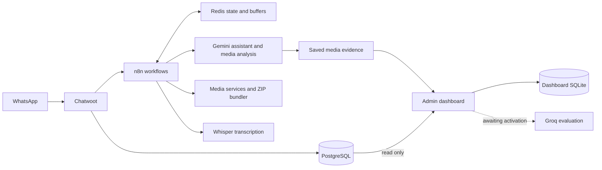

# El Azazy AI Operations Platform

A portfolio source release of a WhatsApp customer-service and print-order automation platform, integrating Chatwoot, n8n, AI media processing, and a bilingual administrator dashboard.

## Highlights

- Stateful customer-service and order workflows with Redis buffering, deduplication, tool execution and human handoff.
- Structured pricing lookup and order progress tracking.
- Gemini media analysis, existing Whisper voice transcription integration, document handling and bounded video-frame analysis.
- Customer-file ZIP archives with manifests and optional duplicate preservation.
- English/Arabic dashboard with RTL, agent analytics, conversation/media review, responsibility evidence and workload observations.
- Chatwoot administrator credential login, MFA-compatible flow, encrypted sessions, CSRF controls and read-only database access.
- Admin corrections, versioned learning examples and evaluation rules.
- Encrypted daily backups and verified isolated recovery.

## Architecture

## Repository layout

| Folder | Contents |
| --- | --- |
| `dashboard/` | Node.js backend, bilingual frontend, evaluation schema and prompt |
| `workflows/` | Sanitized, inactive n8n workflow exports |
| `services/` | Analyzer, bundler, uploader and supporting libraries |
| `integrations/gemini/` | Structured audit-evidence capture and storage helpers |
| `automation/` | Routing scripts, Redis state helpers, pricing utilities |
| `docs/` | Setup, features, release status and publication notes |

## Status and scope

The dashboard and non-evaluation management features were privately deployed. The existing customer-facing Gemini assistant is separate from dashboard evaluation. **Real Groq dashboard evaluation is not activated or end-to-end validated.** The evaluation implementation is included, but no evaluation accuracy or business-impact claim is made.

This is sanitized source for technical review, not a one-click replica of the production installation. Production configuration, data, customer media, screenshots, credentials, private pricing and third-party application code are excluded. Placeholder values and removed n8n credential references must be configured before use. Later chatbot workflow revisions may still require owner-managed import.

See [setup](docs/SETUP.md), [features](docs/FEATURES.md), [verification and limits](docs/STATUS.md), and [publication notes](docs/PUBLISHING.md).

## Technologies

JavaScript, Node.js, HTML/CSS, n8n, Chatwoot APIs, PostgreSQL, SQLite, Redis, Gemini, Groq Whisper, Docker, Linux, Nginx integration, FFmpeg/FFprobe, Sharp, Go, Ruby, Bash.

## Ownership and licensing

This repository contains project-specific integration and application code; Chatwoot, n8n and other dependencies remain subject to their respective licenses. No blanket open-source license is granted here. Confirm the business owner's permission and code ownership before public publication or adding a license.
